<div align="center">



</div>


## 01 · DESCRIÇÃO GERAL

**EQ-2026** é um estudante de Engenharia de Computação em Piracicaba, SP, que gosta de unir software e hardware. Programa em C e C#, monta circuitos com Arduino e modela peças em 3D no Autodesk Inventor. Em busca da primeira oportunidade na área de tecnologia.


## 02 · CARACTERÍSTICAS

- Programação em **C** e **C#**
- Projetos com **Arduino**, **eletrônica** e **modelagem 3D**
- Foco em **automação e hardware**
- Aberto a oportunidades de **estágio**


## 03 · ESPECIFICAÇÕES TÉCNICAS

| PARÂMETRO | VALOR |
|:--|:--|
| Linguagens | C, C# |
| Placa | Arduino |
| Modelagem | Autodesk Inventor |
| Ferramentas | VS Code, Visual Studio |
| Foco | Automação e hardware |
| Objetivo | Estágio em tecnologia |


## 04 · CONFIGURAÇÃO DOS PINOS

```text
              ┌──────∪──────┐
      GITHUB ─┤ 1         8 ├─ VCC
    LINKEDIN ─┤ 2         7 ├─ C / C#
      E-MAIL ─┤ 3         6 ├─ ARDUINO
         GND ─┤ 4         5 ├─ INVENTOR
              └─────────────┘
```

| PINO | NOME | LIGAÇÃO |
|:-:|:--|:--|
| 1 | GITHUB | [github.com/enricoqueiroz](https://github.com/enricoqueiroz) |
| 2 | LINKEDIN | [linkedin.com/in/enricoqueiroz](https://www.linkedin.com/in/enricoqueiroz) |
| 3 | E-MAIL | [enricoqueiroz10@gmail.com](mailto:enricoqueiroz10@gmail.com) |


## 05 · APLICAÇÕES

<div align="center">

<a href="https://github.com/enricoqueiroz/smart-planter"></a>
<a href="https://github.com/enricoqueiroz/operacao-risco-zero"></a>

</div>


## 06 · INFORMAÇÕES PARA PEDIDO

| CÓDIGO | STATUS | LOCAL | DISPONIBILIDADE |
|:--|:--|:--|:--|
| **EQ-2026** | Ativo | Piracicaba, SP | **Aberto a estágio** |

<div align="center">

<sub><code>EQ-2026 · REV. A · FIM DO DOCUMENTO</code></sub>

</div>
